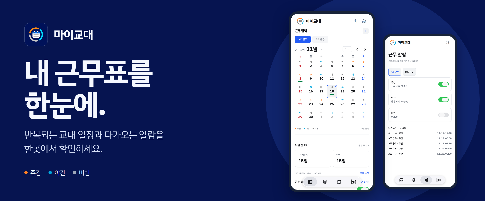
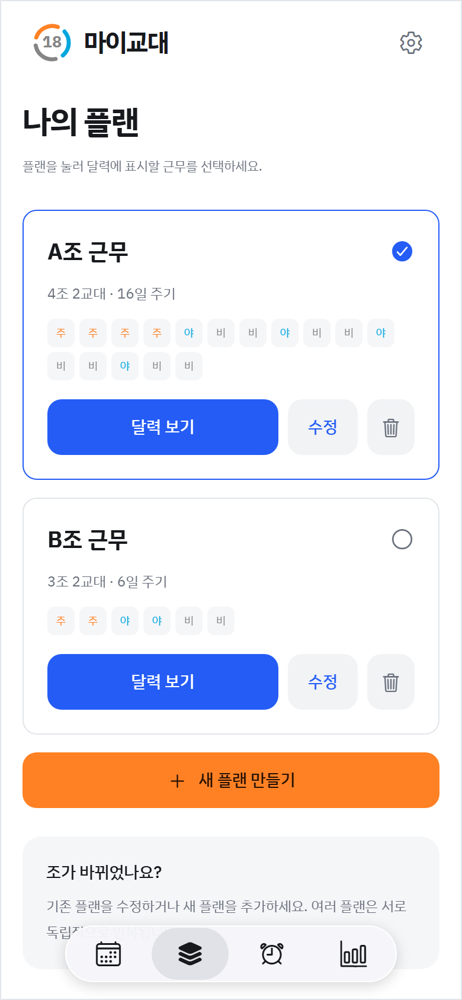
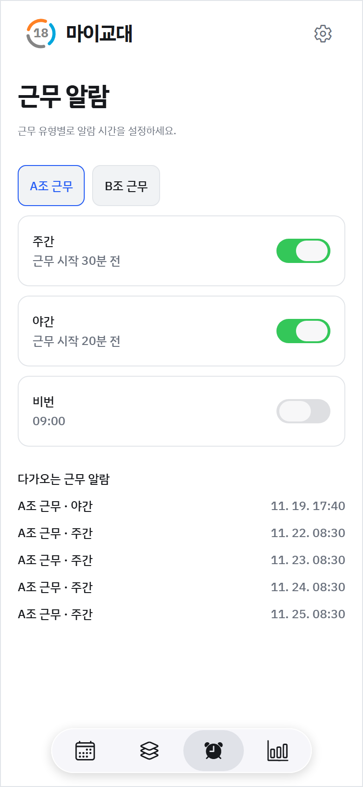
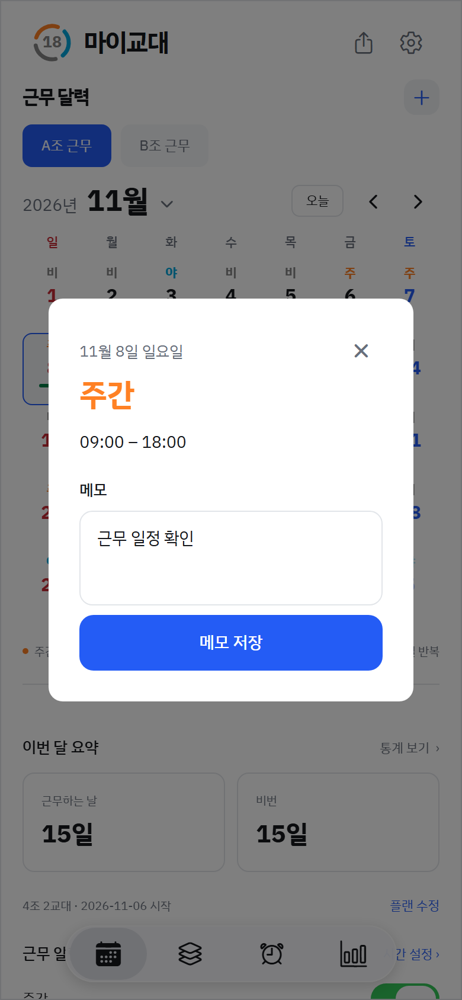

# 마이교대

**Android와 iPhone에서 쓰는 교대근무 달력입니다.** 주간·야간·비번이 돌아오는 날을 한눈에 보고, 근무에 맞춰 알람을 설정하세요.

  
  

<a href="https://github.com/doraemyon/my-shift-app/releases/tag/v1.0.4">v1.0.4 변경 내역</a> · Android 7 이상 · ARM64 · iOS 16.4 이상

[Android 설치](#android-설치) · [iPhone 개인 서명 및 설치](#iphone-설치)

[주요 기능](#주요-기능) · [화면 미리 보기](#화면-미리-보기) · [설치 안내](#설치하고-시작하기)

---

## 내 교대 일정에 맞는 달력

첫 근무 날짜와 반복 순서를 정하면 달력에 근무가 자동으로 표시됩니다. 이번 주 야간 근무를 확인하거나 다음 달 비번에 맞춰 약속을 잡을 수 있습니다. 근무조가 바뀌면 기존 플랜을 수정하거나 별도의 플랜을 추가하세요.

## 주요 기능

| 기능 | 할 수 있는 일 |
| --- | --- |
| 교대 패턴 | 4조 2교대나 3조 2교대 등의 프리셋을 선택하거나 근무 순서를 직접 만듭니다. 근무 이름, 한 글자 표기, 시작·종료 시간도 바꿀 수 있습니다. |
| 여러 근무 플랜 | 회사나 근무조별로 플랜을 저장하고, 달력에 표시할 플랜을 선택합니다. |
| 날짜 메모 | 인수인계나 개인 일정을 날짜에 남깁니다. 달력에서 메모가 있는 날을 확인할 수 있습니다. |
| 한국 공휴일 | 한국천문연구원 공식 공휴일 정보를 자동으로 갱신해 대체공휴일과 임시공휴일 변경을 반영합니다. 받은 정보는 오프라인에서도 볼 수 있습니다. |
| 근무 알람 | 주간·야간은 근무 시작 몇 분 전이나 지정한 시각에, 비번은 원하는 시각에 알람을 설정합니다. |
| 기기 달력 연동 | Android 기기 달력과 iPhone 캘린더에 날짜 메모와 함께 하루 한 건의 종일 일정 또는 짧은 일정을 등록합니다. 제목에 플랜 이름과 근무 표기를 함께 넣거나 하나만 넣을 수 있습니다. |
| Google 캘린더 연동 | Android 기기에 로그인한 Google 계정의 동기화 가능한 달력에 근무표와 메모를 등록합니다. |
| 월간 근무표 공유 | 보고 있는 달의 근무표를 이미지로 공유합니다. |
| 근무 통계 | 주간·월간 예정 근무시간, 근무일, 비번을 확인합니다. |
| 화면 모드와 앱 잠금 | 시스템·라이트·다크 모드를 선택합니다. 지원 기기에서는 지문, 얼굴 인식 또는 기기 암호로 앱을 잠글 수 있습니다. |

## 화면 미리 보기

Android 화면 예시입니다.

<table>
  <tr>
    <td align="center"> 주간·야간·비번을 한눈에</td>
    <td align="center"> 근무조별 플랜 선택</td>
    <td align="center"> 근무별 알람과 예정 시간</td>
  </tr>
  <tr>
    <td align="center"> 근무 상세와 날짜 메모</td>
    <td align="center"> 주간·월간 예정 근무시간</td>
    <td align="center"> 다크 모드 달력</td>
  </tr>
</table>

## 설치하고 시작하기

### Android 설치

1. [Releases](https://github.com/doraemyon/my-shift-app/releases/)에서 최신 버전의 **Assets**를 열고 `.apk` 파일을 받으세요.
2. Android에서 받은 파일을 열어 설치하세요. 설치 권한을 묻는 경우 화면 안내에 따라 해당 앱의 설치 권한을 허용하세요.
3. 첫 플랜의 이름과 근무 패턴, 표기, 시작 날짜를 정하면 근무표를 볼 수 있습니다.

GitHub에서 배포한 v1.0.3에 새 APK를 이어서 설치해 업데이트할 수 있습니다.

### iPhone 설치

iOS 16.4 이상에서 사용할 수 있습니다. IPA는 본인의 Apple 계정으로 개인 서명한 뒤 설치합니다. Windows에서 진행할 수 있습니다.

1. PC에서 [AltStore Classic Windows 설치 안내](https://faq.altstore.io/altstore-classic/how-to-install-altstore-windows)에 따라 iTunes, iCloud, AltServer를 준비합니다. USB로 iPhone을 연결하고 AltServer의 **Install AltStore**에서 기기를 선택합니다.
2. iPhone의 **설정 → 일반 → VPN 및 기기 관리**에서 본인 Apple 계정을 신뢰합니다. 이어서 **설정 → 개인정보 보호 및 보안 → 개발자 모드**를 켜고, 재시동 후 화면 안내를 따릅니다.
3. iPhone의 Safari에서 [마이교대 v1.0.4 IPA](https://github.com/doraemyon/my-shift-app/releases/download/v1.0.4/my-shift-app-ios-v1.0.4.ipa)를 다운로드해 파일 앱에 저장합니다.
4. AltServer가 켜진 PC에 iPhone을 계속 연결한 상태로, iPhone의 **AltStore → My Apps → +**에서 받은 IPA를 선택해 설치합니다.

무료 Apple 계정으로 서명하면 7일마다 갱신이 필요합니다. 만료 전에 PC의 AltServer가 켜진 상태에서 AltStore의 **My Apps → Refresh All**을 사용하세요. [AltStore 갱신 안내](https://faq.altstore.io/altstore-classic/your-altstore)

iPhone에서는 기기 캘린더 연동과 iOS 알림으로 근무 알람을 사용합니다. 앱에서 Google 계정으로 직접 로그인하는 연동은 별도의 설정이 필요합니다.

## 권한과 데이터

플랜과 날짜 메모는 기기에 저장합니다. 달력 연동을 켜면 선택한 플랜의 일정과 메모가 해당 달력에도 추가됩니다. Google 캘린더를 연결할 때는 Android 설정에서 Google 계정의 달력 동기화를 켜 주세요. 근무 알람을 설정할 때는 Android에서 알림과 정확한 알람 권한을 허용해 주세요.

[개인정보 처리방침](PRIVACY.md)
